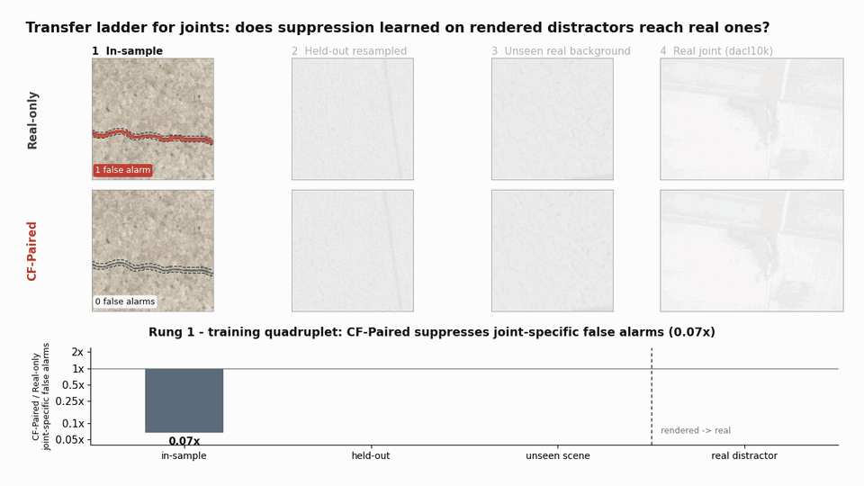
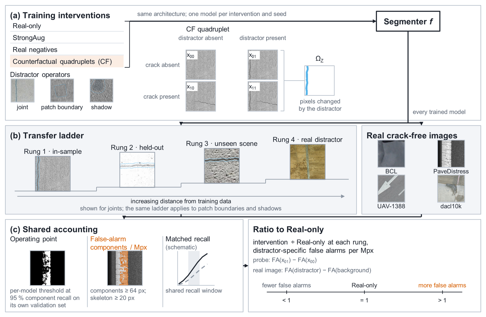
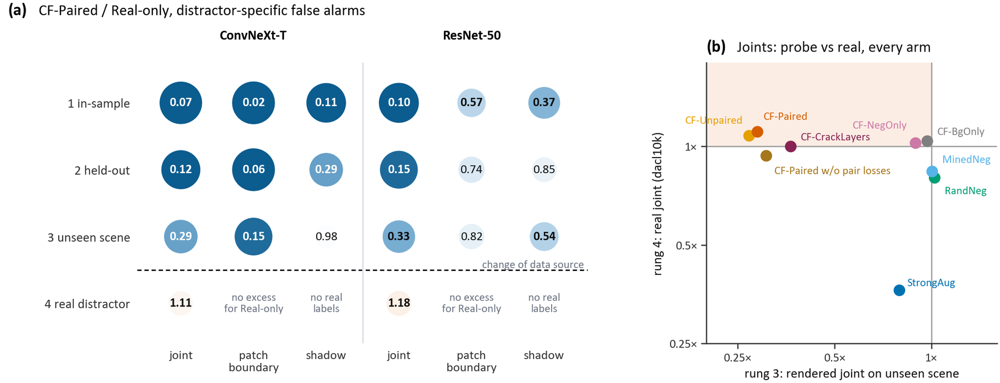
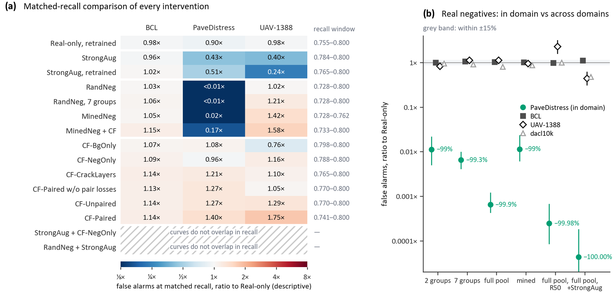

# Rendered silence does not transfer

**A transfer-ladder audit of counterfactual supervision for pavement crack false alarms**

<p align="center">
  
  
  
  
</p>

<p align="center">
  
  <br>
  <sub>The transfer ladder for joints (<a href="docs/media/transfer_ladder.mp4">MP4</a>). Red: false-alarm components at each model's own operating point; dashed: the distractor. Bars: joint-specific false alarms of CF-Paired relative to Real-only over all samples of each rung.</sub>
</p>

Code, configuration and analysis reports for the paper *Rendered silence does not transfer: a transfer-ladder audit of counterfactual supervision for pavement crack false alarms*.

Counterfactual synthetic data render the same pavement background with and without a distractor (joint, patch boundary, shadow) and a crack. They promise to stop crack segmenters from firing on crack-like structures, but are usually validated on images from the same renderer. This study audits whether that suppression reaches real pavement.

## Key findings

- **Silence on rendered distractors does not transfer to real ones.** Joint-specific false alarms of the counterfactual model were 0.07, 0.12 and 0.29 of the Real-only level on training, resampled and unseen-scene probes, and 1.11 on real bridge joints.
- **Counterfactual supervision raised real false alarms.** Relative to training on real positives only, false alarms rose on all five real crack-free legs (for example +18.6% on BCL and +79.1% on UAV-1388), on two backbones and at matched recall.
- **The rise comes with the rendered images.** Renderings without any distractor raised real false alarms on BCL as much as distractor negatives did (+15.4% against +15.6%).
- **What does help.** Real crack-free crops removed in-domain false alarms almost entirely (−99.9%) but transferred unpredictably to other sensors. Strong photometric augmentation lowered cross-domain false alarms at matched recall.

## Method at a glance

<p align="center"></p>

The study has four elements:

- **Account.** False alarms are counted as filtered connected components per megapixel on real crack-free images, at a per-model operating point (95% component recall on the model's own validation set) and at matched recall.
- **Transfer ladder.** The ladder moves from training quadruplets, to resampled quadruplets, to rendered distractors on unseen real backgrounds, to real distractors; each step removes one way of passing a synthetic test without learning the distractor.
- **Distractor-specific counts.** Each rung counts the false alarms caused by the distractor itself (on the distractor image minus on the same scene without it, or, on real images, on the distractor minus on the surrounding background).
- **Interventions.** Counterfactual training is compared with real positives only, strong augmentation, random and mined real negatives, and a decomposition of the synthetic design.

## Results at a glance

<p align="center"></p>

<p align="center"></p>

The scripts are the ones used for the study. They are released for transparency and reproduction, not as a packaged library. Paths are configurable, but the stages expect the data layout produced by the earlier stages.

## Repository layout

| Directory | Contents |
|---|---|
| `poc/` | Shared primitives (`common.py`: I/O, 8-connected components, skeletons, component filter, metrics) and the data stages: download and licence capture (`s00`), per-image registry (`s01`), near-duplicate removal (`s02`), route-block splits (`s03`), negative-pool screening (`s05`), published-model accounting study (`s06`, with model adapters in `poc/adapters/`) |
| `render/` | Distractor operators (`operators/`: joint, patch boundary, shadow, acquisition, visibility), quadruplet construction with the texture-transfer crack brush (`quadruplet.py`) and the rendering and calibration tools (`tools/`) |
| `train/` | Students (`student_v1/v4/v5/v6.py`), schedulers (`run_*.py`), evaluators (`eval_students_v2.py`, `eval_strata_v4.py`, `eval_sdnet_v2.py`, `eval_sweep_v1.py`), threshold sealing, evaluation chains (`*_chain_*.sh`) and analysis (`analyze_*.py`) |
| `baselines/strongaug/` | Trainer and sealed protocol of the StrongAug arm (photometric and degradation augmentation, `augment.py`) |
| `posthoc/` | Post hoc analyses: distractor-specific ladder, alternative accounts and two-level bootstrap (`review_reanalysis_v1.py`), in-domain recall on annotated PaveDistress frames (`anchor_recall_v1.py`), 100 m route clusters (`cluster100m_v1.py`), filtered alerts of published models (`ed1_filtered_alerts_v1.py`) |
| `configs/` | Data sources (`datasets.yaml`), operators (`operators.yaml`), training arms (`e1_arms*.yaml`), pre-registration snapshots (`prereg.yaml`, `prereg_v6.yaml`) and the experiment programme with its addenda (`experiment_program_v1*.yaml`) |
| `results/` | Analysis reports from which the numbers in the paper and its supplementary material are taken (see below) |
| `tests/` | Unit tests for the operators and the quadruplet construction |

Versioned file names (`_v1`, `_v4`, …) are kept as they were run. Each training arm was produced by the student version listed in `train/eval_models_*.json`:

| Student | Arms |
|---|---|
| `student_v1` | Real-only, RandNeg and MinedNeg |
| `student_v4` | CF-Unpaired and CF-Paired |
| `student_v5` | Decomposition and later arms |
| `student_v6` | Retrained Real-only and the ResNet-50 arms |
| `baselines/strongaug` | StrongAug |

## Installation

Python 3.11 with a CUDA build of PyTorch was used (PyTorch 2.5.1, torchvision 0.20.1, timm 1.0.25, segmentation-models-pytorch 0.5.0). Install the packages with:

```bash
pip install -r requirements.txt
```

Students are UPerNet models from `segmentation_models_pytorch` with a ConvNeXt-T (`tu-convnext_tiny`) or ResNet-50 encoder. The published-model adapters in `poc/adapters/` need the original repositories and weights of those models, which are not redistributed here (see `configs/models_public.yaml`).

## Data

No images, annotations or model weights are included. All datasets are public and are obtained from their original publishers under their licences. `configs/datasets.yaml` lists every source with its access point, licence and layout, and `poc/s00_download.py` records licence pages and checksums. The paper's Table 2 gives the role of each dataset:

| Role | Datasets |
|---|---|
| Training positives | DeepCrack, CrackTree260, CFD |
| Real negatives | PaveDistress background frames |
| Crack-free test legs | BCL noise images, PaveDistress background (test blocks), UAV-1388 background, dacl10k images without crack labels, PaveDistress Patch frames, SDNET2018 uncracked pavement |
| Positive axis | CrackSC, NHA12D |
| Unseen-scene rung backgrounds | 122 checked SDNET2018 images |

Set the data root once; all stages read from and write to it:

```bash
export CRACKCF_DATA=/path/to/data
```

Model lists (`train/eval_models_*.json`) and the StrongAug protocol refer to checkpoints as `${CRACKCF_DATA}/...`; the evaluators expand the variable.

## Pipeline

Run the stages in this order:

1. **Data registration and splits.** `poc/s00_download.py`, `s01_build_registry.py`, `s02_dedup.py` and `s03_freeze_splits.py`. PaveDistress is split into alternating route blocks of about 2 km with 100 m buffers.
2. **Real negatives.** `train/negpool_screen_r20.py` screens crack-free crops by committee consensus; `train/marking_r20.py` and `train/b3auto_mine_v1.py` mine crops from a baseline's own false alarms.
3. **Quadruplets.** `render/tools/background_pool_v3.py` builds the background pool. `render/tools/visibility_calibration_fit_v1.py` and `alpha_stratify_v1.py` set the visibility thresholds. `render/tools/render_quadruplets_v1.py` renders the training and held-out quadruplets. `render/tools/build_sdnet_probe_root_v1.py` prepares the unseen-scene probes. `train/quadruplet_integrity_v1.py` checks every group.
4. **Training.** Run the `train/run_*.py` schedulers or the student scripts directly, with the arm definitions in `configs/e1_arms*.yaml`. Every arm keeps 16 real positives in each batch of 32 crops and trains for 80k iterations.
5. **Evaluation.** The `train/*_chain_*.sh` scripts run the evaluation in a fixed order:
   1. validation thresholds;
   2. threshold sealing (`seal_thresholds_v1.py`);
   3. test legs;
   4. probe rungs and real distractor strata (`eval_strata_v4.py`);
   5. SDNET2018 (`eval_sdnet_v2.py`);
   6. threshold sweeps (`eval_sweep_v1.py`).

   GPU indices in the chain scripts are those of the original machine.
6. **Analysis.**
   - The confirmatory decision comes from `train/analyze_p5_v1.py`.
   - Consolidated reports and exploratory predictions come from `train/analyze_program_v2.py`; `analyze_program_v2_add7.py` is the same estimator with the addendum-7 contrasts.
   - Scene-novel probes are analysed by `train/analyze_probe_v1.py`.
   - Matched-recall comparisons come from `train/analyze_sweep_v1.py` and `analyze_sweep_overlap_v1.py`.
   - The analyses in `posthoc/` run last.

Confidence intervals are paired cluster-bootstrap intervals (10,000 replicates, seed 0) over route blocks or image groups. All analyses after the confirmatory test are exploratory; the experiment programme and its addenda in `configs/` state which predictions were written before which results.

## Result reports

`results/` holds the reports the paper draws on. Server paths in them are replaced by `${CRACKCF_DATA}` and `${CRACKCF_CODE}`.

| Path | Contents |
|---|---|
| `confirmatory/` | Confirmatory test report and the sealed validation thresholds |
| `program/program_report.json` | Arm-level false-alarm densities on every leg, all comparisons with bootstrap intervals, positive-axis recall, synthetic probes and scored predictions (primary, decomposition and addendum arms) |
| `program/strata_report_h2.json` | Hypothesis H2 and the dacl10k per-class strata |
| `program/add6_*.json`, `program/add7_verdicts.json` | Addenda 6 and 7 |
| `ladder/` | Scene-novel probe reports and the distractor-specific ladder (`review_reanalysis_*.json`) |
| `sweep/` | Threshold sweeps and matched-recall windows |
| `posthoc/` | In-domain recall, 100 m route clusters and filtered alerts of the published models |

## Notes

- Comments, docstrings, messages and free-text configuration fields were translated into English for this release; code and the configuration values that programs read are unchanged from the versions that were run. Several stages record SHA-256 hashes of configuration files (e.g. `FREEZE.json` from `poc/s03_freeze_splits.py`, threshold seals). Because the translated files differ in bytes from the originals, the hashes recorded during the study refer to the untranslated files; a fresh run records and checks the hashes of the files in this repository.
- The StrongAug trainer verifies the hashes of its sealed protocol files at start-up and therefore runs only with the original protocol inputs; it is included so that the augmentation and training procedure can be inspected and reimplemented.

## Citation

The citation will be added when the paper is published.

## Licence

The code in this repository is released under the MIT licence (`LICENSE`). Datasets, third-party models and their weights remain under their own licences and are not part of this repository.
